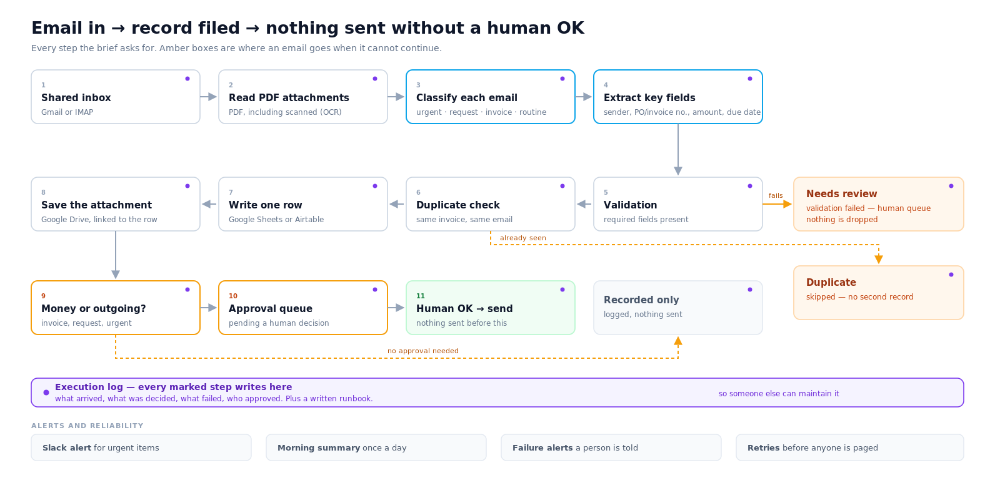

# n8n Inbox Agent — Email → OCR → Classification → Sheet + Drive → Slack Approval → Daily Digest

An end-to-end n8n automation that turns a shared inbox into structured, auditable
records. Every inbound email is read, attachments are OCR'd when needed, the email
is classified, the record is written to Google Sheets, originals are archived to
Google Drive, the team gets a Slack message, and a daily digest is emailed out.

> This repository is a **sanitized demo built for a real Upwork job posting**.
> Credentials, tokens and account-specific IDs have been removed — see
> [Security](#security--sanitization).

---

## 1. What problem it solves

A shared inbox is a black hole: emails pile up, attachments get lost, nothing is
tracked, and nobody knows who approved what.

This agent makes the inbox auditable:

| Pain | What the agent does |
| --- | --- |
| "We lose track of what came in." | Every email becomes a row in Google Sheets. |
| "Attachments are scattered." | Files are archived to a dedicated Drive folder, linked to the row. |
| "Someone has to read every email." | Text extraction + Google Vision OCR, then LLM classification. |
| "People forward the same thing twice." | Server-side de-duplication, with an explicit 409 response. |
| "Nothing gets approved formally." | Anything involving money or a reply waits in an approval queue. |
| "I forget what happened yesterday." | A scheduled morning digest email. |

## 2. How it works

```
Webhook (stands in for Gmail/IMAP in production)
        │
        ▼
Has attachment? ── yes ──► Google Drive upload ──► PDF text extraction
        │                        │                        │
        │                        │                 empty text? ── yes ──► Google Vision OCR
        │                        │                        │                        │
        ▼                        ▼                        ▼                        ▼
  email body text  ────────────────────────────►  LLM classify + extract (DeepSeek)
                                                          │
                                                   validation ── fail ──► needs review
                                                          │
                                                    duplicate? ── yes ──► 409, no new row
                                                          │
                                   ┌──────────────────────┼───────────────────────┐
                                   ▼                      ▼                       ▼
                            Google Sheets           Google Drive           approval queue
                            (append row)          (link on the row)      (pending, Postgres)
                                                                                  │
                                                              ┌───────────────────┘
                                                              ▼
                                                   Slack #inbox-approvals
                                                   (urgent items → #inbox-urgent)

Daily 08:00 → digest query → Gmail  (counts by type and status, last 24h)
Every 10 min → approval poller → executes only rows a human marked approved
```

**Stack:** n8n · PostgreSQL (storage, queue, de-duplication) · Google Sheets API ·
Google Drive API · Google Vision OCR · DeepSeek (swappable for OpenAI/Claude) ·
Slack API · Gmail OAuth.

## 3. Requirements → evidence

Each claim is backed by a file in this repo.

| Requirement | Evidence |
| --- | --- |
| Real, working workflow (not a mockup) | [`workflow/inbox-agent.json`](workflow/inbox-agent.json) and `screenshots/01-Canvas.png` |
| Runs repeatedly in practice | `screenshots/02-executions.png` (successful runs and 409 conflicts) |
| OCR + classification actually execute | `screenshots/03-ocr-run.png`, `screenshots/03-ocr-run2.png` |
| Data lands in the sheet | `screenshots/04-googlesheet-Inbox.png` |
| Attachments archived | `screenshots/05-Drive-folder.png` |
| Approval notification sent | `screenshots/06-slack-approval.png` |
| Scheduled digest works | `screenshots/07-digest-email.png` |
| Queue, dedupe and processed flag | `screenshots/08-approval-queue.png` and `docs/setup-guide.md` §C |

## 4. Repository layout

```
n8n-inbox-agent-demo/
├── README.md
├── workflow/
│   └── inbox-agent.json      # sanitized export
├── screenshots/              # canvas, executions, OCR run, sheet, Drive, Slack, digest
├── docs/
│   └── setup-guide.md        # import, configure, verify
└── scripts/
    └── sanitize_workflow.py  # strips credentials/pinData before publishing


## 5. Importing it

1. Import `workflow/inbox-agent.json` into n8n.
2. Recreate credentials — they are intentionally absent:

   | Node | Credential type |
   | --- | --- |
   | Google Drive upload | Google Drive OAuth2 API |
   | Google Sheets append | Google Sheets OAuth2 API |
   | Morning digest | Gmail OAuth2 API |
   | Slack alerts (×2) | Slack API |
   | Vision OCR | Query Auth (parameter name `key`) |
   | Database nodes | PostgreSQL |

3. Select the Drive folder, spreadsheet, Slack channels and digest recipient.
4. Publish, then call `POST /webhook/inbox-agent`.

Full details: [`docs/setup-guide.md`](docs/setup-guide.md).

## 6. Verification

One full run must satisfy all three:

1. **n8n** — the latest execution is green, no failed nodes.
2. **Server check** — the newest `inbox_messages` row, a matching `pending` row in
   `approval_queue`, and a duplicate check that returns 0 rows.
3. **Three-way match** — the newest Sheet row, the Drive file and the Slack message
   describe the same record.

```sql
-- newest record
SELECT id, message_type, status, dedupe_key, summary
FROM inbox_messages ORDER BY id DESC LIMIT 1;

-- its approval row
SELECT id, message_id, status, processed
FROM approval_queue ORDER BY id DESC LIMIT 1;

-- dedupe: re-sending the same email must not create a second row
SELECT dedupe_key FROM inbox_messages
WHERE dedupe_key = '<key from the first query>'
  AND id <> <id from the first query>;
-- expect: 0 rows
```

## 7. Security & sanitization

The export was cleaned with `scripts/sanitize_workflow.py`:

```bash
python3 scripts/sanitize_workflow.py inbox-agent.json clean.json --aggressive
```

It removes node/root `credentials`, `pinData` and `webhookId`, and masks tokens,
emails and long account IDs. Never commit `.env`, `docker-compose.yml` or DB dumps.

## 8. Known limitations

- The webhook stands in for the inbox; in production it is replaced by a Gmail
  Trigger or IMAP node. Classification and storage logic are unchanged.
- Google Vision's synchronous `files:annotate` handles the first 5 pages of a PDF.
  Longer scanned documents need the asynchronous batch API with Cloud Storage.
- OCR failures are non-fatal: the email continues to review rather than being dropped.
- The LLM step uses DeepSeek here; switching to OpenAI or Claude is a change of
  URL, model name and credential in one node.

## 9. Contact

Available for similar n8n / workflow-automation builds.
